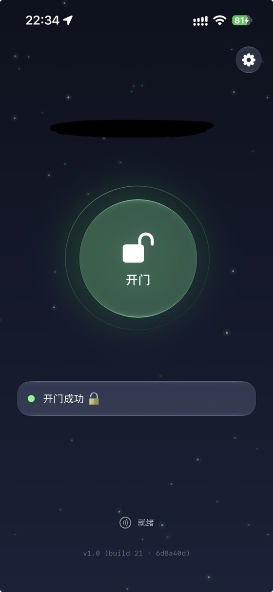

# 门钥 · SEU Dorm Unlock for iOS

  
   首页 · 开门成功（iOS 26，设备号已打码）

「住理生活」门锁系统的**非官方 iOS 客户端**：用**你自己的账号**登录，换取**你自己绑定的门锁**的开门凭据，通过**蓝牙 / NFC** 开门，并支持锁屏小组件、锁屏控制和 Action 按钮。

> 与武汉辛纳电子科技、「住理生活」官方 App 没有任何关联，也不使用其名称、图标或素材。
>
> 基于 [Haa1024/SEU-Door-Unlock](https://github.com/Haa1024/SEU-Door-Unlock)（Android，MIT）的协议逆向成果，是 **iOS 的独立实现，不是 Android 版的完整复刻**。

## 目录

- [预期用法](#预期用法)
- [安装](#安装)
- [首次配置](#首次配置)
- [特性](#特性)
- [文档](#文档)
- [验证状态](#验证状态)
- [免责声明](#免责声明)
- [致谢与许可](#致谢与许可)

---

## 预期用法

三种入口，从最直接到最省事：

### 1. 打开 App，点「开门」

首页中间的大按钮。点一下，App 自动扫描门锁、连接、开门；过程中有搜索 / 成功 / 失败的视觉和触感反馈。

> 如果设备支持 NFC（见[安装](#安装)），App 在前台时还会持续监听，**把手机直接贴近门锁感应区**也能开门。

### 2. 锁屏放小组件，点一下开门

长按锁屏 → **自定义** → 点时间下方的小组件栏 → 添加「门钥」小组件（圆形 / 矩形 / 行内任选）。以后在锁屏**点一下它**，解锁后 App 自动打开并**立刻开始蓝牙开门**，不用再找按钮。

iOS 18 及以上还可以把锁屏左下 / 右下角的按钮换成「门钥 · 开门」控制，一键直达。

### 3. Action 按钮 → 快捷指令「开门」

支持 Action 按钮的机型：**设置 → 操作按钮 → 快捷指令 → 选择「开门」**。按一下实体按钮，App 打开并开始开门。

同一个快捷指令动作还能用于：控制中心 / 锁屏的快捷指令控件、轻点背面、对 Siri 说「用门钥开门」。

> 三种入口的详细步骤、截图位置和注意事项见 [docs/USAGE.md](docs/USAGE.md)。

---

## 安装

> 📦 构建产物放在 [Releases](../../releases) 里（当前 [v1.0.0](../../releases/tag/v1.0.0)）。想自己构建，见 [docs/BUILD.md](docs/BUILD.md)。

本项目是 `.ipa` 文件，需要**侧载**。分两步：

**第一步：准备一个侧载环境（二选一）**

| | TrollStore | SideStore |
|---|---|---|
| 官方教程 | [ios.cfw.guide 安装教程](https://ios.cfw.guide/installing-trollstore/) · [项目主页](https://github.com/opa334/TrollStore) | [官方文档](https://docs.sidestore.io/) · [安装前准备](https://docs.sidestore.io/docs/installation/prerequisites) · [项目主页](https://github.com/SideStore/SideStore) |
| 适用 | 仅限特定 iOS 版本（以其官方说明为准） | 大多数 iOS 版本，需要 Apple ID |
| 蓝牙开门 | ✅ | ✅ |
| **NFC 开门** | ✅ | ❌ 免费 Apple ID 申请不到所需权限 |
| 签名有效期 | 永久 | 7 天，需要刷新（SideStore 可自动刷新） |

> 想要 NFC，只能用 TrollStore（或越狱、付费开发者账号）。原因见 [docs/NFC-AND-SIDELOADING.md](docs/NFC-AND-SIDELOADING.md)。只用蓝牙的话，两种都可以。

**第二步：从 [Releases](../../releases) 下载 `.ipa`，用上面的工具安装**

按所选工具的官方教程安装 `.ipa` 文件即可。装好后桌面上是「门钥」。

> ⚠️ 用 SideStore + 免费 Apple ID 时：
> - 免费账号**滚动 7 天内最多 10 个 App ID**，本 App 的小组件扩展要多占 1 个。额度不够时侧载工具会提示"移除 app extension"，选了之后就没有锁屏小组件 / 控制，但**快捷指令「开门」动作不受影响**。
> - 设置页「关于」里会显示"小组件扩展：已安装 / 未安装"，装完可以一眼确认。
>
> 详见 [docs/INSTALL.md](docs/INSTALL.md)。

---

## 首次配置

打开 App → 右上角齿轮进入设置：

1. **登录并拉取凭据**：输入住理生活的手机号和密码 → 「登录并拉取门锁凭证」。设备号、凭据等参数自动填入。
   - ⚠️ 这会把官方 App 的登录会话顶下线（服务端单点登录的行为）。
2. 回首页，点「开门」试一下。

**第二台设备**：可以在已配置的设备上「导出配置码」，在另一台设备「从剪贴板导入」，免去再登录一次。但**导入的凭据目前观察到会失效**，更适合作为备用，见 [docs/VERIFICATION.md](docs/VERIFICATION.md)。

---

## 特性

**开门**
- 蓝牙开门：全流程自动；缓存外设 UUID 直连，跳过广播扫描，失败自动回退扫描
- NFC 碰锁开门（需 TrollStore / 越狱 / 付费账号）：App 前台持续监听，开完继续监听
- 密钥轮换：NFC 开门后自动保存锁返回的新钥匙
- 凭据自动刷新：离线次数用完 / 凭据过期时从服务器重取并重试（⚠️ 未经真机验证）

**入口**
- 锁屏 / 主屏小组件、iOS 18 锁屏控制、快捷指令「开门」动作（Action 按钮、轻点背面、Siri）

**体验**
- iOS 26 Liquid Glass 适配，低版本自动退回常规材质；按钮样式可选玻璃实心 / 玻璃透明 / 实色 / 描边透明
- 开门过程：待机呼吸与陀螺仪视差；开门中背景变暗、bloom 与 RGB 分离的"蓄力"和跃迁粒子；成功闪绿、失败闪红并抖动
- CoreHaptics 触感（iPhone 8+）：搜索持续嗡鸣并渐强，成功是类似支付成功的双击，失败是两下强抖
- 自定义首页背景图；几乎所有视觉 / 触感参数可在设置页「视觉与震动调节」里调，含试震按钮

**安全与可见性**
- 密码存 Keychain；所有数据只在本机
- 首页底部和设置页「关于」显示版本、构建号、commit，并检测小组件扩展是否装上

---

## 文档

| 文档 | 内容 |
|---|---|
| [docs/USAGE.md](docs/USAGE.md) | 三种入口的详细步骤；NFC 监听；配置码；视觉 / 触感参数 |
| [docs/INSTALL.md](docs/INSTALL.md) | TrollStore / SideStore 的差异、App ID 配额、常见问题 |
| [docs/NFC-AND-SIDELOADING.md](docs/NFC-AND-SIDELOADING.md) | 为什么侧载通常用不了 NFC，TrollStore / 越狱却可以 |
| [docs/VS-ANDROID.md](docs/VS-ANDROID.md) | 和 Android 版的对照：移植了什么、没移植什么、iOS 上做不到什么 |
| [docs/VERIFICATION.md](docs/VERIFICATION.md) | 哪些功能在真机上验证过，哪些没有 |
| [docs/BUILD.md](docs/BUILD.md) | 用 GitHub Actions 构建、签名流程、发布 |

协议细节（BLE / NFC 帧格式、密钥派生）请看上游的 [README-NFC.md](https://github.com/Haa1024/SEU-Door-Unlock/blob/main/README-NFC.md)。

---

## 验证状态

| 项目 | 状态 |
|---|---|
| 蓝牙开门、登录、拉取凭据 | ✅ 真机验证 |
| NFC 开门 | ✅ iPhone 7 + TrollStore |
| 锁屏小组件、锁屏控制 | ✅ 真机验证 |
| 快捷指令「开门」动作 | ✅ 真机验证 |
| 配置码导出 / 导入 | ⚠️ 可以导入，但导入的凭据似乎会失效 |
| 凭据自动刷新（锁返回 `25` / `24` / `27`） | ⚠️ 逻辑已移植，没在真机上触发过 |

完整说明见 [docs/VERIFICATION.md](docs/VERIFICATION.md)。

---

## 免责声明

本软件仅供学习研究蓝牙低功耗 / NFC 通信协议使用。**只应使用你自己账号换取的凭据，开启你有合法使用权的门锁。** 本项目不提供、也不会加入任何绕过他人账号鉴权、批量或通用开锁的功能。请勿用于非法侵入他人住所或任何违法违规用途。因使用本软件产生的一切后果由使用者自行承担。

所有数据只保存在设备本地，不会上传到第三方；唯一的网络请求是向官方服务器登录和拉取你自己的凭据。

## 致谢与许可

本项目建立在 **[Haa1024/SEU-Door-Unlock](https://github.com/Haa1024/SEU-Door-Unlock)** 及其贡献者对"住理生活"门锁协议的逆向分析之上。没有他们公开的 BLE / NFC 帧格式、密钥派生与接口细节，就没有这个 iOS 版本。衷心感谢。

以 MIT 许可发布，**保留上游的版权与许可声明**，见 [LICENSE](LICENSE)。
